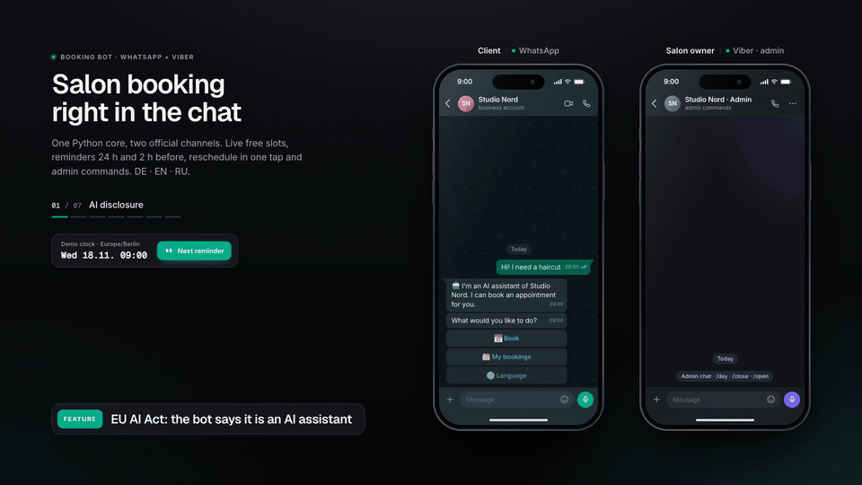
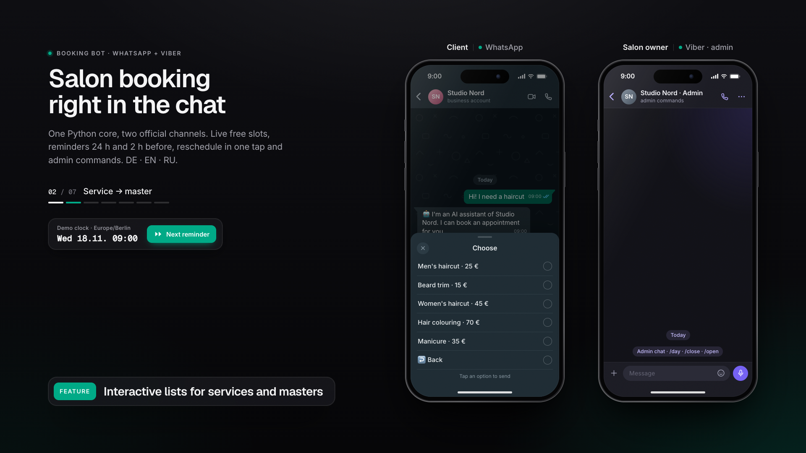
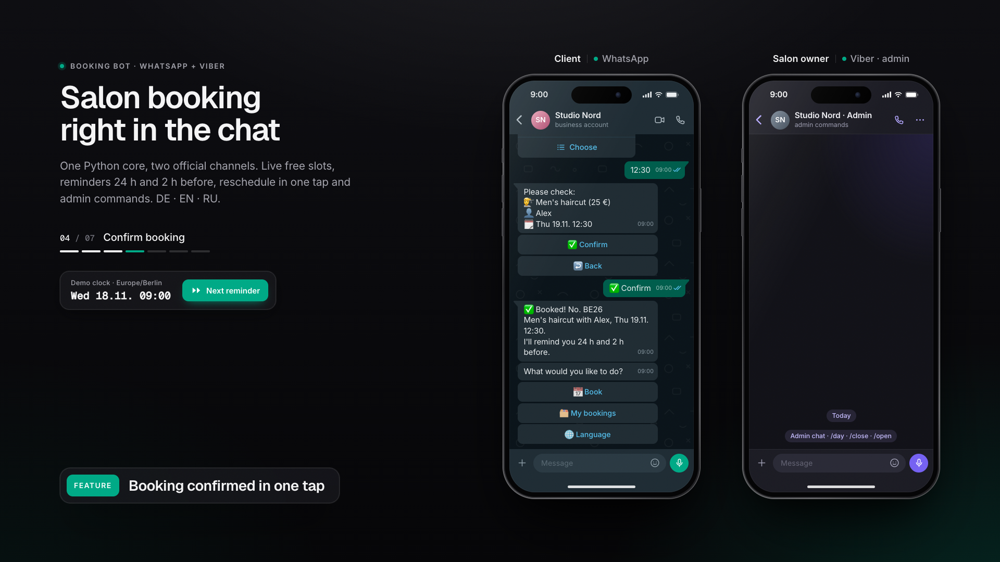
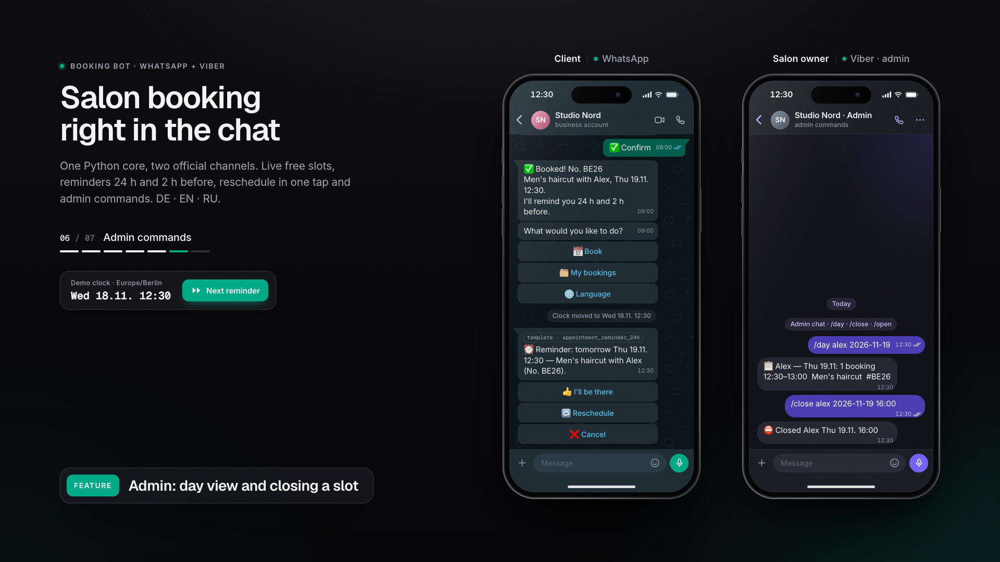
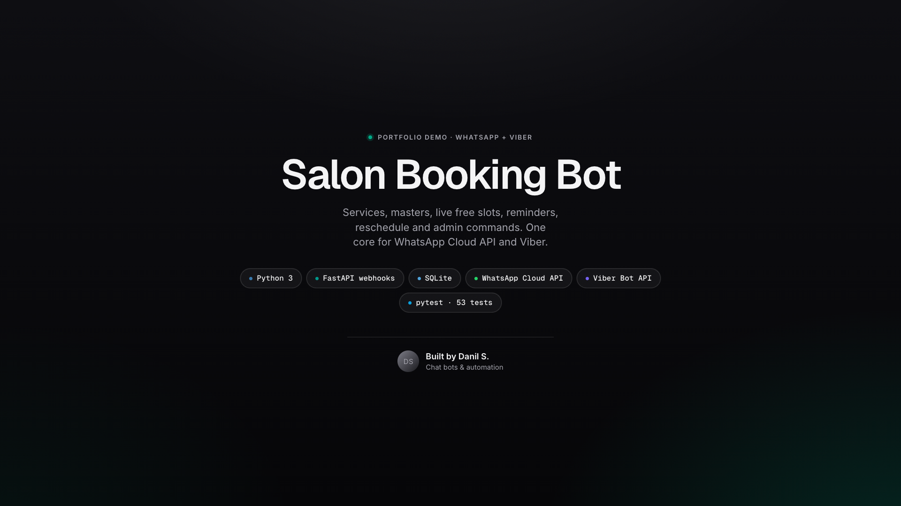

# Booking Bot: WhatsApp + Viber

An appointment booking bot for salons, barbershops and solo masters. **One Python core** handles the conversation, and **thin adapters** connect it to the WhatsApp Cloud API, the Viber Bot API and a local emulator.



▶️ **Full demo video (about 50 s, 1080p 60 fps):**

https://github.com/user-attachments/assets/ee093938-beb4-49d7-b479-a780f99c997c

| Pick a service | Booked |
|---|---|
|  |  |
| **Reminder + admin** | **Summary** |
|  |  |

## What it does
- **Flow:** service → master (skipped if only one master offers it) → free days → free slots → summary → confirm → booking number.
- **Real availability:** each master has working hours per weekday. Slots respect the service length (30/60/90 min), existing bookings, closed slots and a 60-minute lead time. If two clients race for the same slot, only one gets it.
- **Reminders 24 h and 2 h before**, each with buttons *I'll be there / Reschedule / Cancel*. A reminder is never sent twice. Bookings made less than 24 h ahead skip the 24 h reminder. A rescheduled booking gets fresh reminders.
- **My bookings:** cancel or reschedule. Rescheduling keeps the booking number and frees the old slot.
- **Admin commands** (from numbers listed in `ADMIN_IDS`):
  - `/day <master> [YYYY-MM-DD]`: the master's day (bookings and closed slots)
  - `/close <master> <YYYY-MM-DD> <HH:MM>` and `/open …`: close or reopen a slot
- **Languages:** DE / EN / RU. The bot guesses the language from the first message, and the user can switch at any time.
- **EU AI Act, art. 50:** the first message says *"Ich bin ein KI-Assistent / I'm an AI assistant / Я ИИ-ассистент"*.
- **Typed input works too:** "1", "2" or a button title behaves like a tap. Unknown text gets a polite answer and the buttons are shown again.
- **Optional export:** the `BookingExporter` interface comes with `CsvExporter` (works today) and a `GoogleSheetsExporter` stub, ready for a client's service account. If the export fails, booking still works.

## Architecture
```
app/
  core/engine.py      dialog state machine, slots, reminders, admin (messenger-agnostic)
  core/db.py          SQLite: sessions, bookings, closed slots
  core/i18n.py        DE/EN/RU texts
  core/models.py      Out(text, buttons, template) / Incoming
  adapters/whatsapp.py  Cloud API: webhook parse, X-Hub-Signature-256, buttons ≤3 / list ≤10, templates
  adapters/viber.py     Viber: X-Viber-Content-Signature, keyboard, welcome on conversation_started
  adapters/emulator.py  renders the exact WhatsApp payloads for the demo page
  export.py           BookingExporter: Null / CSV / Google Sheets stub
  main.py             FastAPI: /webhook/whatsapp, /webhook/viber, /api/emu/*, reminder loop
demo/index.html       local WhatsApp-style emulator (client phone + admin phone + time travel)
tests/                53 pytest scenarios, WhatsApp & Viber HTTP mocked
scripts/record_demo.py  Playwright → demo.mp4 + screenshots
```
To add another messenger (Telegram, Instagram, SMS), write one adapter with `parse()`, `send()` and `verify_signature()`. The core stays unchanged.

## Run locally (no accounts needed)
```bash
python3.12 -m venv .venv && .venv/bin/pip install -r requirements.txt
.venv/bin/python -m pytest -q                         # 53 passed
.venv/bin/uvicorn app.main:app --host 127.0.0.1 --port 8090
open http://127.0.0.1:8090/demo/                      # emulator
```
The **⏩ Next reminder** button moves the demo clock forward, so you can see reminders without waiting 24 h.

## Go live
1. Copy `.env.example` to `.env` and fill in the tokens. Set `DEMO_MODE=0`.
2. Deploy behind HTTPS. For EU clients, use EU hosting and sign a DPA (AV-Vertrag) under GDPR.
3. **WhatsApp:** Meta App → WhatsApp → Configuration. Set the webhook to `https://<host>/webhook/whatsapp`, set the verify token to `WA_VERIFY_TOKEN`, and subscribe to `messages`. Then create the utility templates `appointment_reminder_24h` and `appointment_reminder_2h` in each language. Each needs 4 body variables (service, master, time, code) and 3 quick-reply buttons.
4. **Viber:** call `ViberAdapter.set_webhook("https://<host>/webhook/viber")` once.
5. Edit `app/salon.json` to set the services, prices, masters and hours.

## Platform notes (checked 19.11.2026)
### WhatsApp Cloud API
- **Official API only.** Unofficial libraries (Baileys, whatsapp-web.js) break Meta's ToS, and Meta bans the number without appeal. This bot talks only to `graph.facebook.com`.
- **Test number:** adding WhatsApp to a Meta developer app creates a test business account and a test phone number automatically. It can send **free messages to up to 5 verified recipient numbers**. The temporary access token lasts about 24 h, so production needs a system-user token. You need a Meta developer account (free).
- **Pricing:** since **1 July 2025** Meta charges **per delivered message**, not per conversation. The rate depends on the category (marketing / utility / authentication / service) and the recipient's country. Messages from the user are free.
  - **Service messages** are free-form replies inside the **24 h customer-service window**. From 1 Oct 2026, each number gets 1,000 free per month, then they are charged.
  - **Utility templates sent inside an open window** were free from July 2025. **They are charged again from 1 Oct 2026.**
  - **Germany, approximate rates:** utility ≈ €0.046 per message, marketing ≈ €0.113 per message. These come from our 2026 research; check them against Meta's current rate card. A salon sending about 300 reminders a month pays about €14/month in Meta fees.
  - Messages inside a free entry-point window (opened from a Click-to-WhatsApp ad, up to 7 days) are free.
- **Template rules:**
  - Outside the 24 h window you may send **only pre-approved templates**. This bot sends reminders as templates when the window is closed and as interactive messages when it is open.
  - Reminders belong in the **utility** category: transactional and tied to the user's booking, with no promo. Any promotional wording makes Meta (re)categorise the template as marketing, which costs more. Meta also re-checks approved templates later.
  - OTP codes are allowed only in authentication templates.
  - Since 15 Jan 2026, **general-purpose AI chatbots are banned** on WhatsApp. A bot for one business's own tasks (booking, FAQ) is allowed.
- **Limits used in the code:** up to 3 reply buttons, each title up to 20 characters. A list message holds up to 10 rows (row title up to 24 characters, description up to 72). Interactive body text is up to 1,024 characters.

### Viber Bot API
- Since **5 Feb 2024**, new bots run on the **commercial model**. Creating a bot is free, but it needs Viber's approval and signed commercial terms.
- The fee is **€100 per month per bot**. One reseller page quotes €115, which we could not confirm. The fee can also be set in a written agreement. Bots created before 5 Feb 2024 stay on the old model.
- **Replies inside a user session (24 h) are included in the fee.** **Messages the bot starts itself (reminders!) are charged on top**, at per-country rates.
- So Viber makes sense where the clients actually use Viber (UA, BG, GR, Balkans, Eastern Europe). In Germany, WhatsApp is the main channel.

## Not included on purpose
- Unofficial WhatsApp clients, mass messaging, marketing blasts.
- Payments and deposits: easy to add (Stripe link) if a client needs them.

## License
MIT. See [LICENSE](LICENSE).
